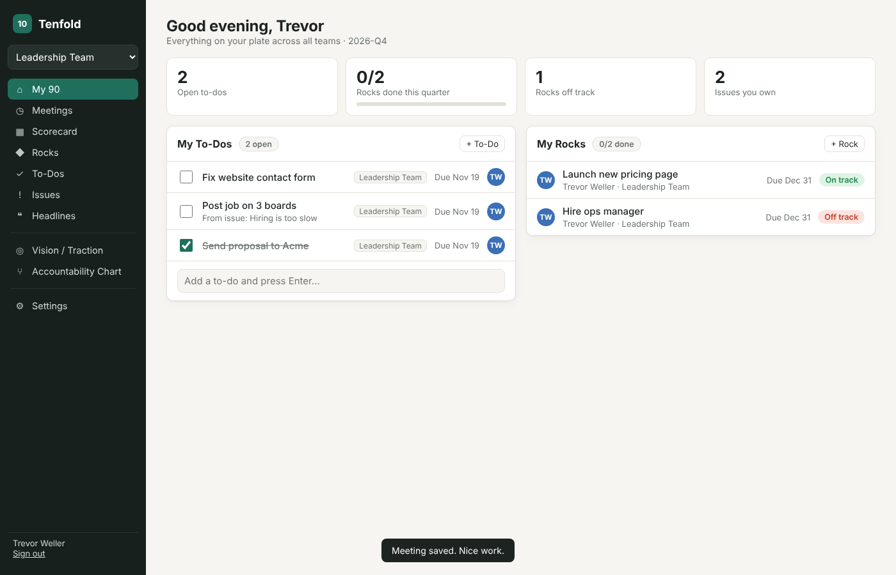
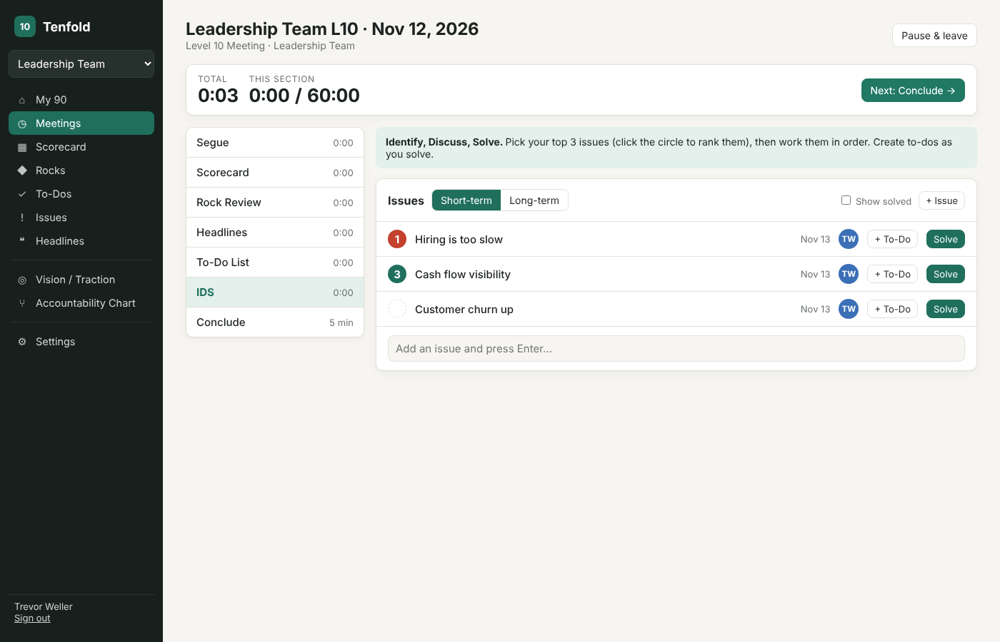
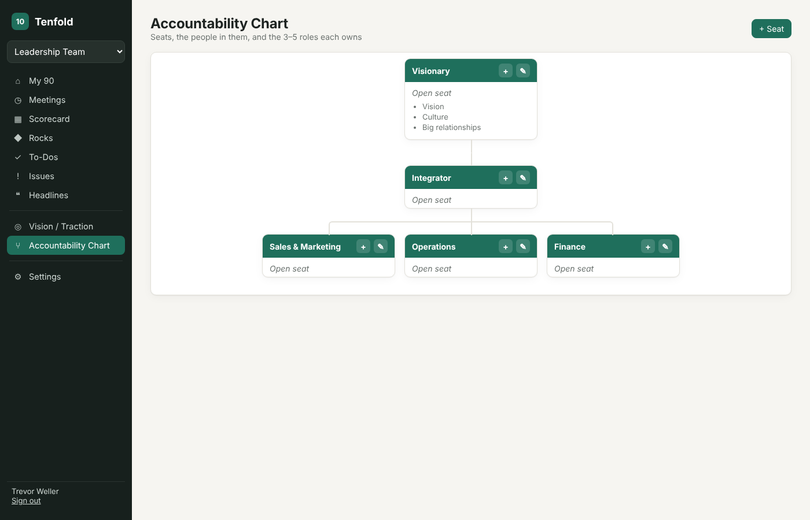
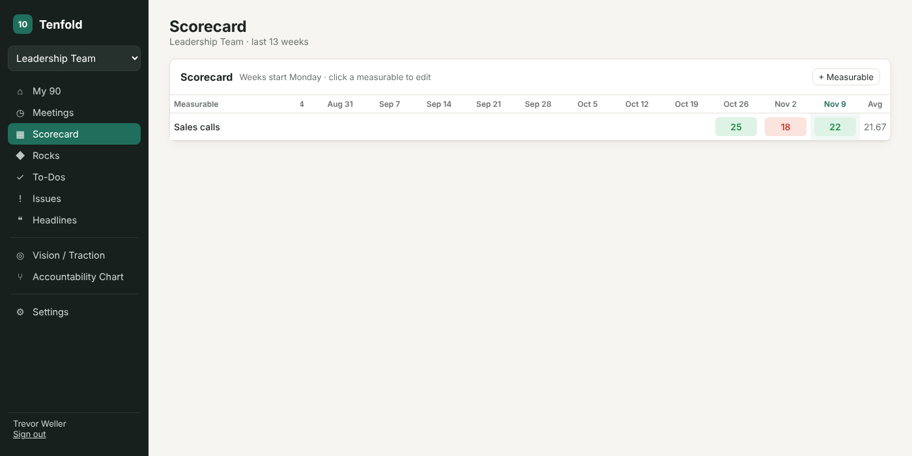

# Tenfold

A small, self-hosted team tool for running your business on EOS®-style practices, meant for a handful of friends or a small team. It runs as one tiny Docker container with no external dependencies: Python's standard library plus a SQLite file.



## Features

| Tool | What it does |
|---|---|
| **My 90** | Personal dashboard: your to-dos, rocks and issues across every team |
| **Level 10 Meetings** | Guided weekly meeting with a timer per agenda section (Segue → Scorecard → Rock Review → Headlines → To-Dos → IDS → Conclude), ratings, cascading messages and meeting history |
| **Scorecard** | Weekly measurables with goals, 13-week grid, red/green highlighting, averages |
| **Rocks** | Quarterly priorities with owners, due dates and on/off-track status |
| **To-Dos** | 7-day action items, quick add, overdue flags, on-time completion rate |
| **Issues** | Short- and long-term lists, top-3 ranking, solve, turn into to-dos |
| **Headlines** | Customer and employee news, drop down to issues |
| **Vision / Traction Organizer** | Core values, core focus, 10-year target, marketing strategy, 3-year picture, 1-year plan; pulls in current rocks and long-term issues. Autosaves |
| **Accountability Chart** | Org chart of seats, the person in each seat, and their roles |
| **Teams and people** | Multiple teams, admin-managed accounts, password changes |

| Meeting runner | Accountability chart | Scorecard |
|---|---|---|
|  |  |  |

> EOS® and Level 10 Meeting™ are trademarks of EOS Worldwide. This project isn't affiliated with EOS Worldwide or Ninety.io.

---

## Part 1: Put it on GitHub

When you push this repo to GitHub, the included GitHub Actions workflow (`.github/workflows/docker-publish.yml`) builds a Docker image automatically and publishes it to the GitHub Container Registry as `ghcr.io/<your-username>/tenfold:latest`. Unraid then installs it like any other app.

### 1. Create the repository
1. Go to <https://github.com/new>.
2. Name it **`tenfold`** and choose Public or Private. Don't add a README, .gitignore or license, since this project already has them.
3. Click **Create repository**.

### 2. Upload the code

**Option A: command line (recommended)**

The folder is already a git repo with one commit. From inside the `tenfold` folder:
```bash
git remote add origin https://github.com/YOUR_GITHUB_USERNAME/tenfold.git
git branch -M main
git push -u origin main
```

**Option B: GitHub Desktop**

Use *File → Add local repository*, pick the `tenfold` folder, then click *Publish repository*.

**Option C: web upload**

On the empty repo page, click *uploading an existing file* and drag in the **contents** of the `tenfold` folder.
⚠️ macOS and Windows hide folders that start with a dot, so `.github` is often skipped. If it is, use *Add file → Create new file*, type the name `.github/workflows/docker-publish.yml`, and paste in that file's contents.

### 3. Let it build
1. Open the repo's **Actions** tab. A run called *Build and publish Docker image* should start within a few seconds. It takes about 2–4 minutes and should finish with a green check.
2. If Actions are disabled, enable them on that tab and click *Run workflow*.

### 4. Make the image public (important)
GitHub makes new container images **private** by default, and Unraid can't pull a private image without a login.
1. Go to your GitHub profile and open the **Packages** tab, then click **tenfold**.
2. Open **Package settings** (bottom right), scroll to *Danger Zone*, choose **Change visibility → Public**, and confirm.

Only the built app becomes public. Your friends' data stays on your server. If you'd rather keep the image private, run `docker login ghcr.io -u YOUR_GITHUB_USERNAME` in the Unraid terminal, using a GitHub personal access token with `read:packages` as the password.

### 5. Set your username in the Unraid files
Replace `YOUR_GITHUB_USERNAME` with your GitHub username, **in lowercase**, in `unraid/tenfold.xml` and `docker-compose.yml`. Then commit and push.

---

## Part 2: Install on Unraid

### Option A: Unraid template (easiest)

1. **Copy the template to the flash drive.** In the Unraid web UI, click the **>_ Terminal** icon (top right) and run:
   ```bash
   wget -O /boot/config/plugins/dockerMan/templates-user/my-tenfold.xml \
     https://raw.githubusercontent.com/YOUR_GITHUB_USERNAME/tenfold/main/unraid/tenfold.xml
   ```
   This needs a public repo. For a private repo, copy the file to the same path with a file manager or SMB share instead (`\\TOWER\flash\config\plugins\dockerMan\templates-user\my-tenfold.xml`).
2. Go to the **Docker** tab and click **Add Container** (at the bottom).
3. In the **Template** dropdown, choose **tenfold** (under *User templates*).
4. Check the fields:
   - **Repository:** `ghcr.io/your-username/tenfold:latest`
   - **Web UI Port:** `8090`. Change it if something else already uses 8090.
   - **Data:** `/mnt/user/appdata/tenfold`
   - **TZ:** your time zone, for example `America/New_York`
5. Click **Apply**. Unraid pulls the image and starts the container.
6. Click the Tenfold icon on the Docker tab and choose **WebUI**, or browse to `http://YOUR-UNRAID-IP:8090`.

### Option B: Add Container by hand (no template)

On the **Docker** tab, click **Add Container** and fill in:

| Field | Value |
|---|---|
| Name | `tenfold` |
| Repository | `ghcr.io/your-username/tenfold:latest` |
| Network Type | `Bridge` |
| WebUI | `http://[IP]:[PORT:8090]/` |

Then use **Add another Path, Port, Variable, Label or Device** to add:

| Config Type | Name | Container value | Host value |
|---|---|---|---|
| Port | Web UI | `8090` | `8090` |
| Path | Data | `/data` | `/mnt/user/appdata/tenfold` |
| Variable | TZ | `TZ` | `America/New_York` |

Click **Apply**.

### Option C: Docker Compose, or build without GitHub

With the **Compose Manager** plugin (*Apps* tab, search "Docker Compose Manager"):
1. Go to *Docker* tab → *Compose* → **Add New Stack**, and name it `tenfold`.
2. Paste in the contents of `docker-compose.yml` with your username filled in, then click **Compose Up**.

To build directly on Unraid without GitHub, copy the project folder to `/mnt/user/appdata/tenfold-src` and run:
```bash
cd /mnt/user/appdata/tenfold-src
docker build -t tenfold .
docker run -d --name tenfold --restart unless-stopped \
  -p 8090:8090 -e TZ=America/New_York \
  -v /mnt/user/appdata/tenfold:/data tenfold
```

---

## Part 3: First run

1. Open the WebUI. The first visit shows **Set up Tenfold**, where you create the admin account and the first team.
2. Go to **Settings → People → + Person** to create an account for each friend. Send them the email and temporary password; they can change it under **Settings → Edit profile**.
3. Add more teams under **Settings → Teams** if you need them. Switch teams with the dropdown at the top left.
4. A suggested order for setting things up: **Accountability Chart → V/TO → Rocks → Scorecard**, then run your first **Level 10 Meeting**.

## Letting friends in from outside your house

Don't forward port 8090 straight to the internet. Two good options:

- **Tailscale (simplest):** install the Tailscale plugin on Unraid and invite your friends to your tailnet (or share the Unraid machine with them). They then use `http://tower-name:8090`.
- **Reverse proxy with HTTPS:** for example Nginx Proxy Manager, SWAG or Cloudflare Tunnel, with a domain like `tenfold.example.com`. When Tenfold is served over HTTPS, set the container variable `COOKIE_SECURE=true`.

## Updating

When you push changes to `main`, GitHub builds a new image. On Unraid, go to the **Docker** tab, click **Check for Updates**, then **apply update** on Tenfold. Your data in `/mnt/user/appdata/tenfold` is kept.

To publish a versioned release, tag it: `git tag v1.1.0 && git push --tags`.

## Backups

Everything is stored in one file, `/mnt/user/appdata/tenfold/tenfold.db` (plus `-wal` and `-shm` files while it's running). The **Appdata Backup** plugin covers it automatically. For a manual backup, stop the container and copy the folder.

## Configuration

| Variable | Default | Purpose |
|---|---|---|
| `PORT` | `8090` | Port the app listens on inside the container |
| `DATA_DIR` | `/data` | Where the database is stored |
| `PUID` / `PGID` | `99` / `100` | User and group that own the data. Unraid's `nobody:users` |
| `COOKIE_SECURE` | `false` | Set to `true` when served over HTTPS |
| `SESSION_DAYS` | `30` | How long a sign-in lasts |
| `TZ` | (none) | Container time zone |

## Running locally (development)

You only need Python 3.10 or newer. No packages to install.
```bash
python3 server.py
# open http://localhost:8090. Data goes in ./data
```

## Troubleshooting

- **"pull access denied" or "unauthorized" when installing:** the GHCR package is still private (see Part 1, step 4), or the username in the repository field isn't all lowercase.
- **The page won't load:** check the container log (Docker tab → Tenfold icon → *Logs*). It should say `Tenfold 1.0.0 running on http://0.0.0.0:8090`. Make sure the host port isn't used by another container.
- **You keep getting signed out over plain HTTP:** make sure `COOKIE_SECURE` is `false` unless you're using HTTPS.
- **Forgot the admin password:** another admin can reset it under Settings → People. If you were the only admin, stop the container, delete `tenfold.db`, and start over (this erases everything), or ask for help resetting it with `sqlite3`.

## License

MIT. See [LICENSE](LICENSE).
